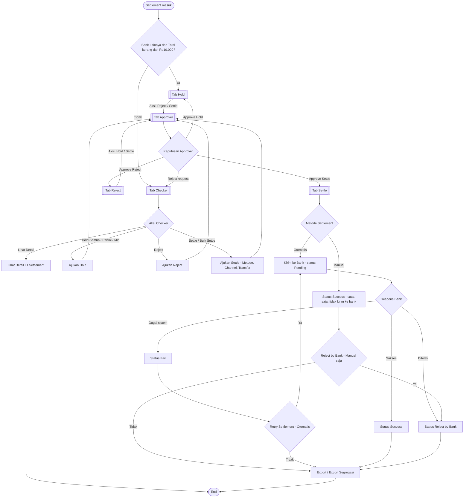
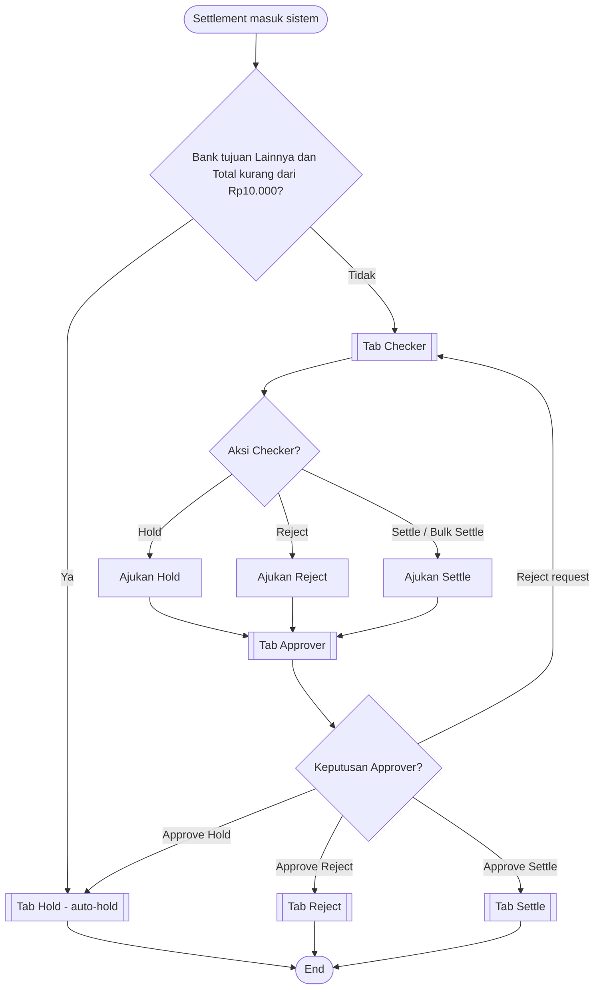
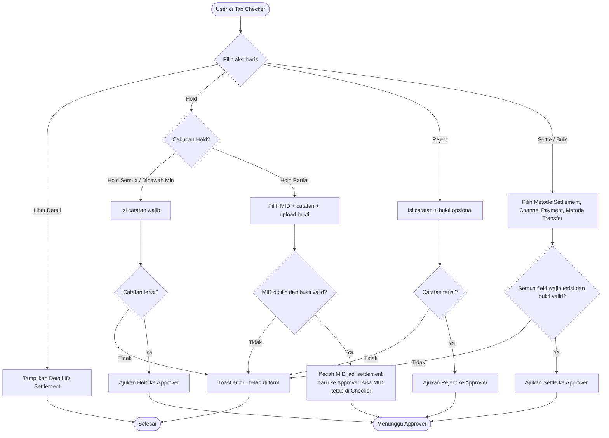
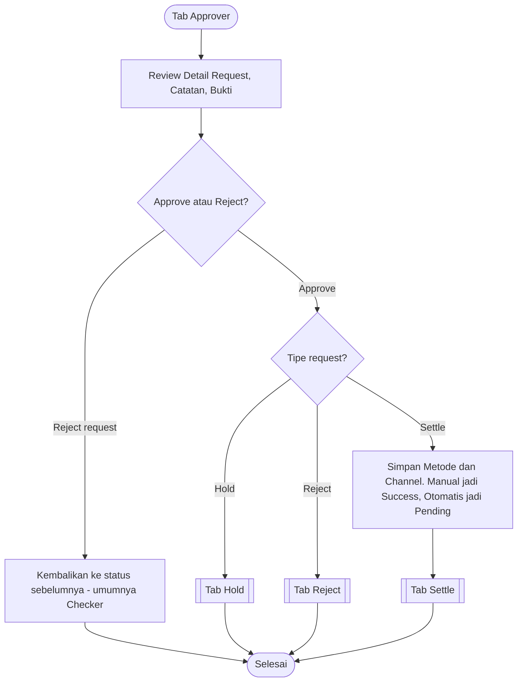
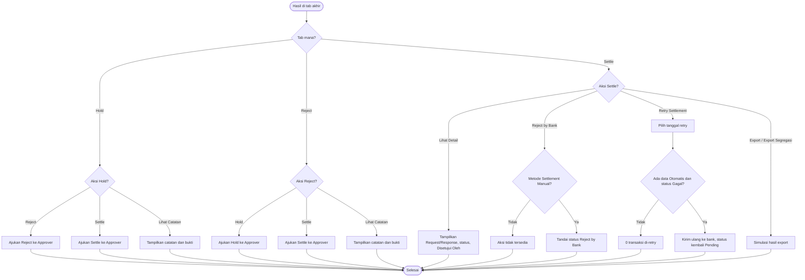
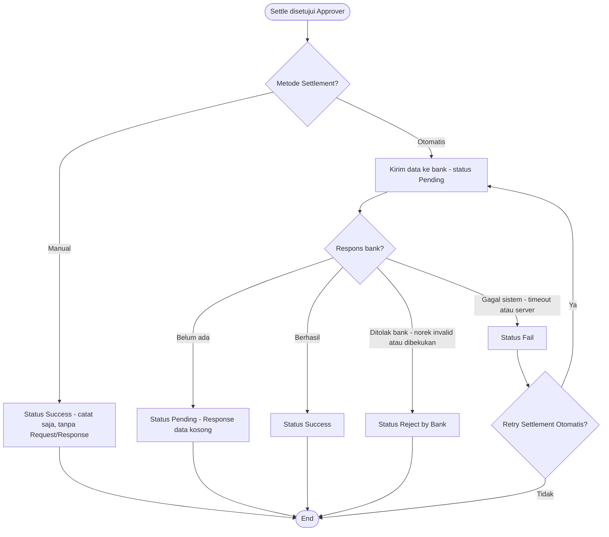
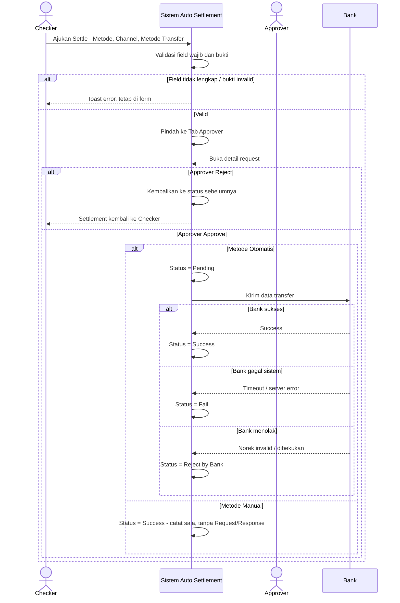
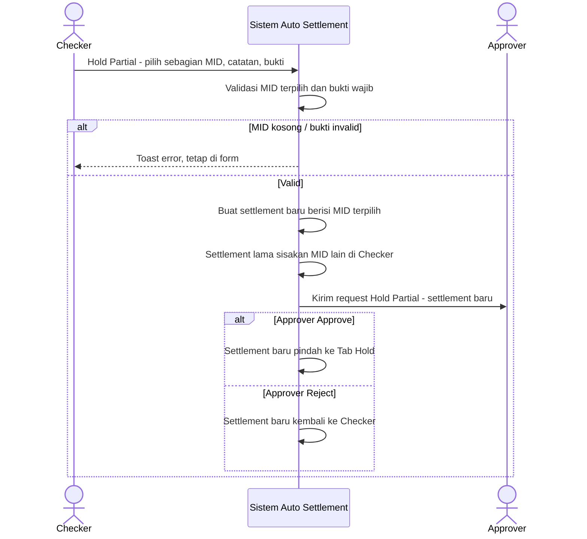
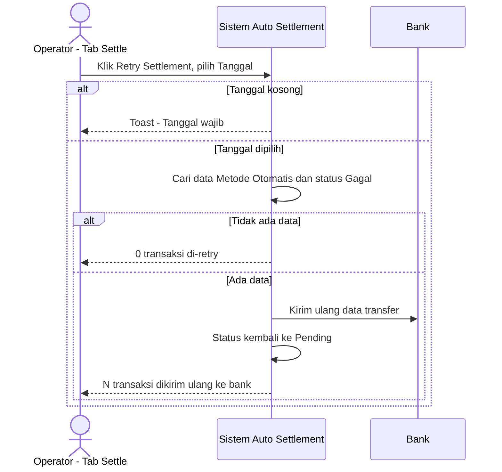

# Flow End-to-End — Auto Settlement

Dokumen ini menggambarkan alur data settlement dari pertama masuk **Tab Checker**, melalui **Approver**, hingga hasil akhir di **Hold / Settle / Reject**. Mencakup happy flow, negative flow, dan edge case untuk setiap kemungkinan keputusan. Semua aksi yang tersedia di halaman ikut dipetakan.

Aksi yang tercakup: Auto-hold, Hold (Semua / Partial / Dibawah Min), Reject, Settle, Bulk Settle, Lihat Detail, Lihat Catatan, Approve/Reject request, Reject by Bank, Retry Settlement, Export, Export Segregasi, serta status Settle (Pending / Success / Fail / Reject by Bank).

---

## 0. Flowchart Ringkas — Satu Chart End-to-End

Ringkasan seluruh fitur Auto Settlement dalam satu diagram: dari data masuk, tahap Checker → Approver, hasil Hold / Settle / Reject, siklus status Settle, hingga Retry, Reject by Bank, dan Export.

> Tombol Export tersedia di tab Checker/Hold/Reject/Settle; Export Segregasi khusus tab Settle. Detail validasi tiap aksi ada di diagram berikutnya.

---

## 1. Flowchart — Alur High-Level End-to-End

---

## 2. Flowchart — Aksi di Tab Checker + Validasi

> Edge case bukti: format selain PDF/JPG/JPEG/PNG atau ukuran lebih dari 25 MB dianggap tidak valid → masuk cabang "Toast error - tetap di form".

---

## 3. Flowchart — Keputusan Approver

> Tab Approver tidak memiliki tombol Export. Aksi hanya Approve, Reject, dan Lihat bukti.

---

## 4. Flowchart — Aksi di Tab Hold / Reject / Settle

> Export Segregasi hanya muncul di Tab Settle dan hanya memuat data Metode Settlement Manual.

---

## 5. Flowchart — Siklus Status di Tab Settle

> Reject by Bank per baris hanya untuk item Manual; item Otomatis yang gagal ditangani lewat Retry Settlement.

---

## 6. Sequence Diagram — Alur Settle (Checker → Approver → Bank)

---

## 7. Sequence Diagram — Hold Partial (Pecah Settlement)

---

## 8. Sequence Diagram — Retry Settlement

